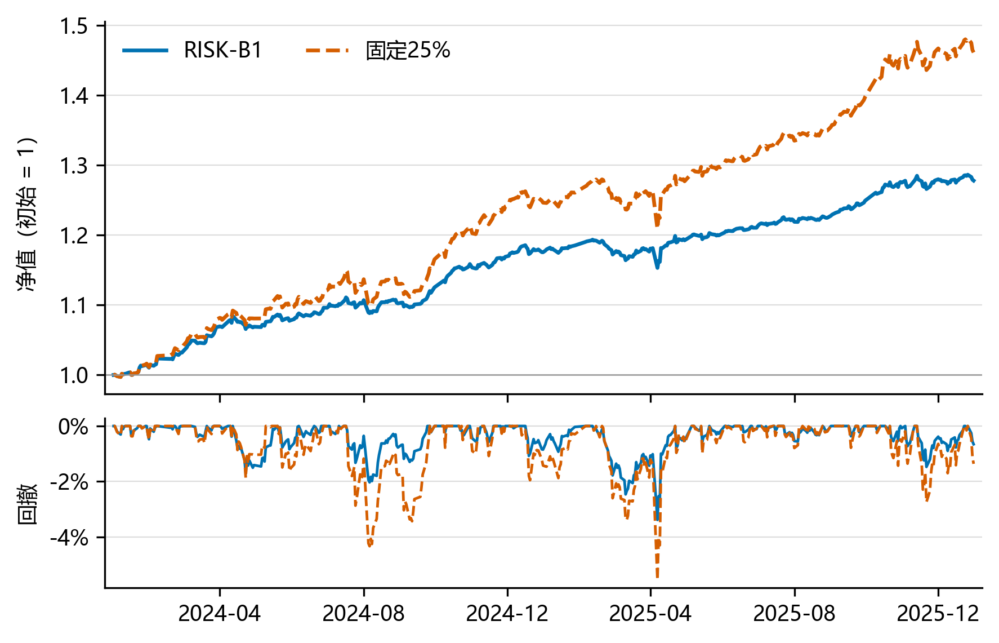

# Multi-Asset Quant Research

**Price-volume stock ranking, cross-asset risk budgets, and executable shared-cash portfolios.**

[中文](README.md) · [Research report, Chinese PDF](docs/strategy-report/report.pdf) · [Data contract](docs/运行与数据契约.md) · [MIT](LICENSE)

The project connects a rolling LightGBM stock-ranking model (E00), a four-sleeve risk-budget allocator (RISK-B1), and a shared-cash ledger. It preserves strong simple controls, weaker periods, and negative results rather than presenting model complexity as investment skill.



## Run without market-data access

Python 3.12 is recommended. From the repository root:

```bash
python -m pip install -r 代码/requirements.txt pytest
python examples/synthetic_risk_budget.py
python -m pytest -q tests
```

The synthetic example calls the existing allocator with simulated returns. It does not download data, train models, or reproduce historical strategy profits. Lightweight tests and the example are configured for Linux CI. Full account reproduction has primarily been tested on Windows.

To rebuild the report figures from included derived strategy results:

```bash
python -m pip install -r docs/strategy-report/requirements.txt
python docs/strategy-report/build_figures.py
```

A CJK font is needed for Chinese chart labels; see the [report build instructions](docs/strategy-report/README.md). The report includes its LaTeX source, four figures, monthly returns, and provenance records.

## Results and trade-offs

The final candidate combines historical CSI 300 constituent stock selection with domestic S&P 500, gold, and government-bond ETFs. Cash earns zero in this study. The fixed-25% control still performs stock selection and periodic rebalancing.

| Period | Standard-cost strategy | Total return | Zero-cash Sharpe | Maximum drawdown |
|---|---|---:|---:|---:|
| 2024–2025, 485 sessions | RISK-B1 | 27.80% | 2.858 | −3.38% |
| Same period | Fixed 25% | 46.13% | 2.642 | −5.55% |
| 2026-01-05 to 09-21, 175 sessions | RISK-B1 | 2.96% | 0.446 | −8.76% |
| Same period | Fixed 25% | 0.52% | 0.122 | −10.22% |

B1 trades lower absolute return for a higher historical Sharpe and shallower drawdown. Gold and the S&P 500 account for about 70% of its historical net profit; this is not evidence that stock-selection alpha explains the portfolio result.

2023 was used for development and 2024–2025 was repeatedly inspected. The 2026 extension is a retrospective, partial-year **cash restart**, not a blind test or a portfolio carried over from 2025. Absolute performance deteriorates considerably. Stress-scenario cash exposure and the mismatch between the stock risk proxy and the actual stock sleeve remain open questions.

## Reproduction levels

1. **Public, self-contained:** synthetic allocator example, lightweight tests, and figure regeneration from derived results.
2. **Frozen-prediction account replay:** requires separately obtained licensed input data; recalculates allocation, trades, fees and account equity.
3. **Historical E00 retraining:** supports 72 monthly fits for 2020–2025 with a 36-month rolling window and matured labels. The packaged 2026 entry point uses frozen scores and does not retrain.

With authorized inputs placed under the ignored `数据/` directory:

```bash
python 代码/run_reproduce.py --data-root 数据 --output-dir outputs/historical --ranking-mode frozen
python 代码/verify_results.py --data-root 数据 --output-dir outputs/historical
python 代码/run_2026_extension.py --data-root 数据 --output-dir outputs/2026
```

See the [full run instructions](代码/README_使用说明.md), [research index](docs/阅读与复现索引.md), and [local recovery boundaries](docs/恢复与主要策略快速复现_20261014.md). Financial features, trend/state rules, sequence models, NLP, attention, stage selection and allocation searches are documented with their actual completion status. Discussed but unimplemented methods are not counted as failed experiments.

## Data, citation and contributions

Stock data and membership came from GoldMiner; risk proxies from Tushare; ETF execution quotes from Eastmoney; corporate actions were checked against available vendor and issuer records. Raw supplier inputs, credentials, private accounts and third-party papers are not redistributed. The public repository alone cannot reconstruct all historical inputs.

Original project code and documentation are available under [MIT](LICENSE); dependency and source rights remain separate. See [third-party notices](THIRD_PARTY_NOTICES.md), [CITATION.cff](CITATION.cff), and [contribution guidelines](CONTRIBUTING.md). Cite the exact commit and evaluation period. This is a historical research artifact, not a live trading service.
