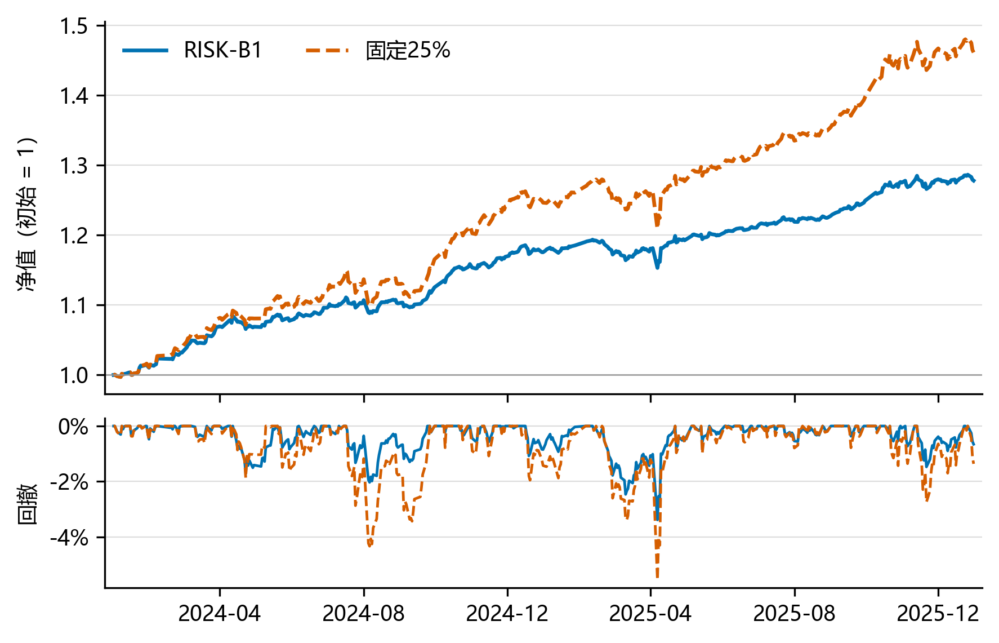

# Multi-Asset Quant Research

**量价选股与跨资产风险预算：从预测排名到可执行组合。**

[English](README.en.md) · [正式研报 PDF](docs/strategy-report/report.pdf) · [运行与数据契约](docs/运行与数据契约.md) · [MIT](LICENSE)

这个项目把三个经常割裂的问题接到同一条可检查的链上：

```text
历史股票池与已成熟标签 → E00滚动量价排序 → 股票候选与预算
                                    ↓
股票风险代理＋标普500＋黄金＋国债 → B1风险预算目标
                                    ↓
             共享现金、整手、费用、公司行为 → 实际持仓与成本后净值
```

股票层回答相对买谁，资产层管理风险承担，账户层检验目标能否落地。研究保留简单强对照、年度失效及未达目标的探索，不以复杂模型数量衡量成效。



## 快速开始：无需数据账号

建议Python 3.12，在仓库根目录运行：

```bash
python -m pip install -r 代码/requirements.txt pytest
python examples/synthetic_risk_budget.py
python -m pytest -q tests
```

合成样例直接调用仓库已有风险预算实现，展示权重、上限和再平衡；不下载行情、不需要GPU或登录。**合成结果不代表真实策略收益。** 已提供Linux CI配置以运行轻量测试与样例；远程执行状态见发布核查；完整历史回放此前主要在Windows测试。

公开结果图也可独立重建：

```bash
python -m pip install -r docs/strategy-report/requirements.txt
python docs/strategy-report/build_figures.py
```

输入为随仓库提供的策略衍生净值、实际权重和贡献CSV，输出四幅图、月度收益及核对文件。中文字体与PDF编译说明见[报告目录](docs/strategy-report/README.md)。

## 主要结果

最终候选为 **E00股票选择＋RISK-B1风险预算**。股票使用历史沪深300成分；境内ETF分别为标普500（513500）、黄金（518800）、国债（511010）。现金允许持有，按零计息。固定25%对照仍进行选股与再平衡，并非完全不操作。

| 区间 | 方案／标准成本 | 累计收益 | 零现金夏普 | 最大回撤 |
|---|---|---:|---:|---:|
| 2024—2025，485日 | B1 | 27.80% | 2.858 | −3.38% |
| 同期 | 固定25% | 46.13% | 2.642 | −5.55% |
| 2026-01-05—09-21，175日 | B1 | 2.96% | 0.446 | −8.76% |
| 同期 | 固定25% | 0.52% | 0.122 | −10.22% |

B1历史夏普更高、回撤较浅，代价是更低累计收益。黄金与标普贡献了历史B1约70%的净利润，不能把组合表现全部归因于选股alpha。2026相对对照仍有优势，绝对表现明显下降。

**评价边界：** 2023用于开发验证，2024—2025被多轮观察；2026为已查看背景的175日事后补充检验，各自100万元现金重启、不继承2025持仓。它不是全年、独立盲测或连续跨年账户。压力情景现金暴露变化、股票风险代理错配等仍有待进一步研究。

## 这里保留了什么

| 模块 | 实际内容 | 入口 |
|---|---|---|
| 股票选择 | 20特征LightGBM，36个月滚动、月度训练、成熟标签筛选 | [训练入口](代码/train_e00.py) |
| 配置与执行 | 20日风险预算；股票与ETF共享现金、整手、T+1、费用与权益事件 | [运行说明](代码/README_使用说明.md) |
| 主结果与归因 | 15页报告、LaTeX、衍生数据、四图及组件贡献 | [正式研报](docs/strategy-report/report.pdf) |
| 扩展研究 | 财务、趋势、区制/序列、NLP、注意力、阶段选择及配置搜索 | [当前证据表](docs/研究路线与证据状态.md)、[研究索引](docs/阅读与复现索引.md)、[历史摘要](results/历史实验摘要/) |
| 工程检查 | 合成样例、关键契约测试和GitHub Actions | [样例](examples/synthetic_risk_budget.py)、[测试](tests/) |

未实现的BLO、DRO、HRP及宏观强化学习等只列为讨论方向，不算失败实验。局部未胜对照不等于整个方法类别无用。原17页提交报告保留于docs，当前阅读入口为新版研报。

## 自备合法数据：复跑账户与训练

供应商原始行情、成分、新闻和事件包不公开分发。拿到符合[数据契约](docs/运行与数据契约.md)的授权输入并放入`数据/`后：

```bash
python 代码/run_reproduce.py --data-root 数据 --output-dir outputs/historical --ranking-mode frozen
python 代码/verify_results.py --data-root 数据 --output-dir outputs/historical
python 代码/run_2026_extension.py --data-root 数据 --output-dir outputs/2026
```

- `frozen`重新计算配置及实际账户，历史六账户，2026另有四账户；不是只读summary，也不是重训。
- `--ranking-mode retrain`支持2020—2025共72个月E00训练再回放；2026入口只使用冻结评分。
- 主要旧分支的本地恢复与缺口见[复现地图](docs/恢复与主要策略快速复现_20261014.md)。公开摘要和代码不意味着所有分支原始输入都可从本仓库取得。

公开仓库单独可运行的是合成样例、测试和结果图；**完整历史训练及账户回放需要额外合法输入**。这三种能力明确区分。

## 数据来源与许可

股票行情及历史成分来自掘金；配置风险代理来自Tushare；境内ETF执行报价来自东方财富；权益事件结合发行人公告等来源核对。详见[数据说明](docs/数据字典与来源.md)。供应商输入再分发权未核验，不提供未经授权的下载镜像。

自有代码和文档采用[MIT许可](LICENSE)，外部依赖与引用保留各自权利，见[第三方说明](THIRD_PARTY_NOTICES.md)。引用本项目请保留具体commit及评价口径，[CITATION.cff](CITATION.cff)提供元数据。

欢迎可复现的问题报告与贡献，参见[贡献指南](CONTRIBUTING.md)。该仓库是历史策略研究，不是实时交易服务；不包含私人账户、访问凭证、供应商数据库或第三方论文PDF。
